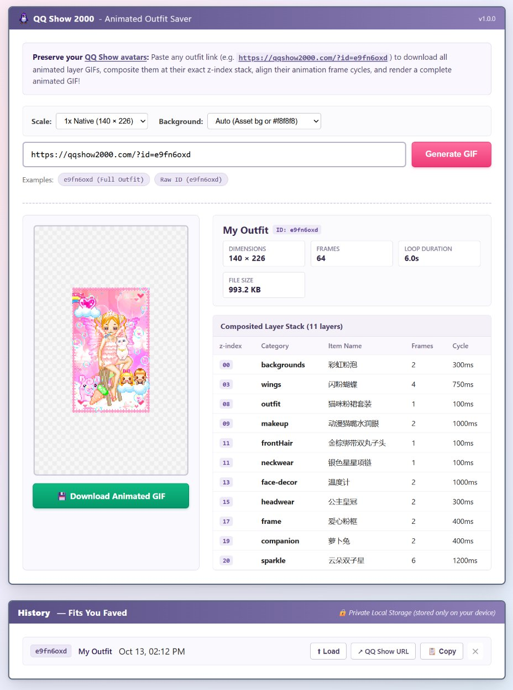

# QQ Show 2000 Outfit Saver 👗✨

> Download, synchronize, and composite animated avatars from [qqshow2000.com](https://qqshow2000.com) into a single, perfectly-looping animated GIF.

<p align="center">
  
  <br>
  <em>Sample composited outfit (ID: <code>e9fn6oxd</code>), with 11 animated layers synchronized at 2x scale</em>
</p>

---

## 🌸 About & Cultural Context

Back in the day, **staRpauSe** had a great time playing with [KiSS dolls](https://en.wikipedia.org/wiki/Kisekae_Set_System) (Kisekae Set System). It's really cool to see early character configurators built for pure personal expression and digital identity. These avatars comfortably predate the modern NFT PFP craze and remain vital cultural touchpoints of early web history to preserve for future generations to discover themselves.

We discovered the QQ Show revival via **[viola.city's Qzone Museum](https://viola.city/projects/qzone-museum/)**, a wonderful rabbit hole into Y2K Chinese web culture.

A huge shout-out to **[Kay Zeng](https://www.kayzeng.com/)** for her brilliant work designing and resurrecting **[qqshow2000.com](https://qqshow2000.com)**!

---

### History of QQ Show (QQ秀)

[QQ](https://en.wikipedia.org/wiki/Tencent_QQ) is a Chinese chat and social media platform created by Tencent in 1999. In 2003, Tencent launched **QQ Show**, a virtual avatar dress-up feature that remained active until 2021. Users could customize their digital personas with clothing and accessories that appeared across the QQ world. 

QQ Show was directly inspired by Sayclub, one of Korea's biggest chat platforms in the 2000s, which gradually lost ground a decade later due to competition and failing to adapt to the emerging smartphone era. In a different trajectory, Tencent won its home market with its technology and product strategy. QQ Show achieved massive scale in China, attracting over 100 million users and establishing virtual goods as a major revenue stream. 

The aesthetic featured the "purikura" and "blingee" style popular in early 2000s Asia: sparkly graphics, bright colors, and maximalist design elements that were part of the broader Y2K cultural movement. Despite shaping the internet culture and aesthetic for hundreds of millions of users in China, QQ Show remains relatively unknown outside the Chinese internet spheres. 

[qqshow2000.com](https://qqshow2000.com) recreates QQ Show using GIF assets recovered from the [Internet Archive Wayback Machine](https://archive.org/), aiming to make its mark on Chinese internet history visible to the international internet community.

> *(qqshow2000.com is designed and made by [Kay Zeng](https://www.kayzeng.com/) as she's thinking about the QQ Show items she bought with her snack money.)*  
> *This is an unofficial, non-profit digital archive project for artistic, educational, and research purposes only. All assets were recovered from the Internet Archive Wayback Machine. Copyright remains with Tencent Holdings Limited. For takedown requests, please contact: qqshow2000project@gmail.com*  
> - **Sep 22, 2025:** website launched with 827 items collected by Kay Zeng  
> - **Oct 17, 2025:** added 200 items collected by @晋文公 from Rednote (小红书)

<details>
<summary><strong>中文简介 (About QQ Show in Chinese)</strong></summary>

[QQ](https://en.wikipedia.org/wiki/Tencent_QQ)是腾讯于1999年创建的中国聊天社交平台。在2003年，腾讯推出了虚拟形象装扮产品QQ秀，用户可以为自己在QQ世界中的数字化身搭配服装和配饰。直至2021年，QQ秀被腾讯下架。 

QQ秀的创建借鉴了Sayclub，2000年代韩国最大的聊天平台之一。Sayclub在后来由于竞争和未能适应新兴的智能手机时代而在韩国逐渐失去了市场地位。腾讯则走向了不同的轨迹，凭借其技术和产品策略赢得了本土市场竞争。QQ秀在中国取得了巨大成功，吸引了超过1亿用户，并确立了虚拟商品作为主要收入来源的商业模式。 

其美学风格具有2000年代初期亚洲流行的"大头贴"和"闪图"特色，包括闪闪发光的图形、明亮的色彩和极繁主义设计元素，这些都是更广泛的Y2K文化运动的一部分。尽管QQ秀影响了中国数亿用户和早期的中国互联网文化审美，但在中文互联网以外仍相对不为人知。此项目使用从[Internet Archive Wayback Machine](https://archive.org/)恢复收集的gif素材重现QQ秀，旨在让中国互联网历史上的这一印记被更广阔的互联网社区看见。


qqshow2000.com由[Kay Zeng](https://www.kayzeng.com/)设计制作。时至今日，她已经忘记了自己曾在QQ秀和各种钻石会员上花了多少钱。

这是一个非官方、非营利的数字档案项目，仅用于艺术、教育和研究目的。所有素材均从Internet Archive Wayback Machine中恢复收集。版权归腾讯控股有限公司所有。如需删除下架，请联系qqshow2000project@gmail.com。

- **2025年9月22日:** 网站上线，收录了827件由Kay Zeng收集整理的装扮  
- **2025年10月17日:** 上新了200件由小红书网友@晋文公收集的装扮

</details>

---

## 💡 Why This Tool?

When you create an outfit on [qqshow2000.com](https://qqshow2000.com) and try to save the avatar image by right-clicking or saving the GIF, the browser only saves **a single layer** (like just the background or hair). This happens because the web app layers dozens of transparent animated GIFs on top of each other using CSS `z-index` and absolute positioning.

Furthermore, each animated layer has its own frame delays and loop timings (e.g. wings flapping every 150ms/300ms, eyes blinking every 500ms, sparkle effects cycling every 200ms).

**QQ Show 2000 Outfit Saver** solves this by:
1. Fetching the shared outfit configuration directly from the database blueprint.
2. Resolving all z-index positions, two-part hairstyles (`frontHair` / `backHair`), defaults, and slot suppression.
3. Calculating the Least Common Multiple (LCM) timeline across all layer frame cycles.
4. Compositing every frame in order with full alpha transparency.
5. Exporting a single, synchronized animated GIF!

---

## 🌐 Live Web App

You can run the web app directly in your browser with **no installation or backend required**:

👉 **[https://starpause.github.io/qqshow2000-outfit-saver/](https://starpause.github.io/qqshow2000-outfit-saver/)**

The entire pipeline runs 100% client-side in the browser: it queries Supabase for the outfit blueprint, fetches the GIF assets, decodes frames via `omggif`, synchronizes the animation timeline, and renders the composite animated GIF using `gifenc`.

<p align="center">
  
</p>

---

## ⚡ Features

- **100% Serverless Web App:** Runs entirely in modern browsers on GitHub Pages or locally.
- **Pixel-Art Crisp Scaling:** Export at native **1x** (140x226) or integer-scaled **2x** (280x452), **3x** (420x678), or **4x** (560x904) with nearest-neighbor interpolation.
- **Background Modes:** `auto` (preserves background scene or canvas), `transparent` (alpha-channel GIF transparency), or custom hex colors.
- **History & Faved Fits:** A built-in browser-local history box (`localStorage`) tracks your saved fits with one-click **Load**, **QQ Show link**, and **Copy URL** buttons. Never posted or stored on any external server.
- **Dual Interfaces:** Use the web app (hosted or local) or the Python **Command Line Interface (CLI)**.
- **Zero Heavy Dependencies:** Python tools require only standard Python 3 and Pillow.

---

## 🛠️ Installation & Local Usage

If you prefer to run it locally or use the CLI:

```bash
git clone https://github.com/starpause/qqshow2000-outfit-saver.git
cd qqshow2000-outfit-saver
pip install pillow
```

### 1. Local Web App

```bash
python server.py
# or
python cli.py --ui
```

Then open **[http://localhost:8080](http://localhost:8080)** in your browser:
- Paste any URL (e.g., `https://qqshow2000.com/?id=e9fn6oxd`) or ID (`e9fn6oxd`).
- Select your **Scale** and **Background** preference.
- Click **Generate GIF** to watch the real-time compositor run.
- Preview the animated GIF, review the layer stack, and click **Download Animated GIF**.
- Your generated outfits are automatically saved in the **History - Fits You Faved** box below.

---


### 2. Command-Line Interface (CLI)

```bash
# Save outfit (defaults to 2x crisp scale)
python cli.py https://qqshow2000.com/?id=e9fn6oxd

# Choose custom scale (1x, 2x, 3x, or 4x)
python cli.py e9fn6oxd -s 1 -o my_fit_1x.gif
python cli.py e9fn6oxd -s 2 -o my_fit_2x.gif

# Export with transparent background
python cli.py e9fn6oxd --bg transparent

# Inspect layers and animation cycles without rendering
python cli.py e9fn6oxd --info
```

CLI `--info` preview output:
```text
[1/3] Fetching outfit 'e9fn6oxd'...
      Found: "My Outfit" (ID: e9fn6oxd)

[2/3] Resolved 11 z-index layers:
      z=00 [backgrounds     ] 彩虹粉泡
      z=03 [wings           ] 闪粉蝴蝶
      z=08 [outfit          ] 猫咪粉裙套装
      z=09 [makeup          ] 动漫猫嘴水润眼
      z=11 [frontHair       ] 金棕绑带双丸子头
      z=11 [neckwear        ] 银色星星项链
      z=13 [face-decor      ] 温度计
      z=15 [headwear        ] 公主皇冠
      z=17 [frame           ] 爱心粉框
      z=19 [companion       ] 萝卜兔
      z=20 [sparkle         ] 云朵双子星
```

---

## 📜 Credits & Disclaimer

- Original QQ Show concept, assets & copyrights belong to **Tencent Holdings Limited (腾讯控股有限公司)**.
- Digital archive & website by **[Kay Zeng](https://www.kayzeng.com/)** at **[qqshow2000.com](https://qqshow2000.com)**.
- Inquiries / Wayback Machine archive project: `qqshow2000project@gmail.com`.
- Inspired by discovery via **[viola.city](https://viola.city/projects/qzone-museum/)**.
- Compositor tool by **[staRpauSe](https://github.com/starpause)**.
